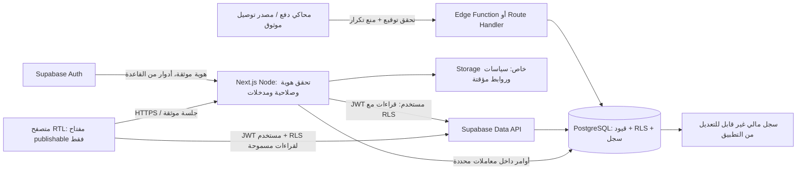

# 4A — بنية التشغيل وحدود الثقة

## الحالة التي فُحصت

المشروع الحالي Next.js App Router (النسخة المثبتة 16.4.6)، مع React 19 وTypeScript، و`output:'export'` و`trailingSlash:true`. المسارات تُصدّر من `app/[...slug]/page.tsx`. الواجهة العامة ولوحتا البائع والإدارة تعمل من `DemoProvider`، والمفتاح `sanaa-demo-v4` مع ترحيل v2/v3. الوظائف السابقة تبقى محاكاة محلية واضحة؛ ليست مصادقة أو بيانات مالية إنتاجية.

نقطة الرجوع: `backup/before-phase4a` عند `6dc8589c1bcc1a7106bb34b08c084dc01bd6875a`. لا تعديل للرئيسية أو اللوحات أو `next.config.ts` أو مفاتيح المتصفح. لا استيراد بيانات شخصية أو جلسات أو كلمات مرور إلى Auth.

## القرار المعماري

تظل نسخة Sites الحالية ثابتة وتعمل كما هي في 4A. المسار المستهدف عند اعتماد 4B: Next.js على استضافة Node تدعم التشغيل الديناميكي (Node 22)، مع Supabase PostgreSQL/Auth/Storage، وSupabase Edge Functions للأحداث الخارجية عند الحاجة. لا نفترض أن استضافة `out/` الحالية تشغّل Server Actions أو API Routes أو Webhooks.

لا يوجد تشغيل لهذا المسار الديناميكي في 4A. ملفات `deployment/` قوالب للمراجعة والتجهيز وليست إعدادات نشر مفعلة. لا تغيير لجمهور الموقع أو ربط استضافة مدفوعة تلقائياً.

## ما لا يستطيع المتصفح تقريره

لا يرسل العميل السعر النهائي أو العمولة أو حالة الدفع أو هوية بائع بديلة. طلب checkout المستقبلي يرسل `cartId/addressId/idempotencyKey` فقط. الخادم يستخرج صاحب الجلسة، ويقرأ الأسعار والقواعد والتغطية، ويقفل المخزون ويحسب ويثبت اللقطات داخل معاملة. بيانات السجل والتسوية لا تُقبل من JSON العميل.

Supabase `service_role` يتجاوز RLS؛ وجوده على الخادم ليس تفويضاً للمستخدم. أي استخدام مستقبلي له يسبقه تحقق هوية وصلاحية صريح، ولا يُحفظ في المتصفح أو ملفات عامة أو `NEXT_PUBLIC_*`. الاعتماد على `user_metadata.role` محظور. دور signup الابتدائي `customer` فقط؛ منح Seller وإدارة الصلاحيات من مسار خادمي مُدقق لاحقاً.

## نموذج الأموال واللقطات

- كل مبلغ بالوحدة الصغرى: 145 AED = 14500 فلس. `bigint` محدود إلى 9,000,000,000,000 فلس لكل حقل، دون floating point. النسب basis points بين 0 و10000.
- `currency_code` قابل للتوسع وAED افتراضي. تجميع مبالغ كبيرة وحسابات النسب في 4E تستخدم BigInt/decimal وتقريباً موثقاً قبل التحويل إلى DTO آمن؛ لا يُفترض أن مجموع ملايين الصفوف يقع داخل حدود Number.
- أسعار الأصناف وأسماؤها ثابتة في `order_items`. قواعد العمولة والعنوان وعرض التوصيل محفوظة كلقطات، مع مراجع لإصداراتها.
- الطلب الرئيسي يجمع مشتريات العميل، وتحته طلبات بائعين، وتحتها أصناف وشحنات. لا تكشف بيانات الطلب الرئيسي للبائع عن البائعين الآخرين.
- عمولة البيع تستبعد التوصيل بقيد صريح. 1000 bps مثال افتراضي غير نشط، وليس اتفاقية تجارية معتمدة.
- عقد التوصيل يدعم fixed/percentage/hybrid والخصم من مستحق الشركة. المثال 2000 فلس عميل، و300 عمولة، و1700 صافي يحتاج عقداً فعالاً وخدمة مؤهلة؛ لا يُضاف 300 فوق فاتورة العميل تلقائياً.
- العمولة ليست إيراداً نهائياً لمجرد تسجيل صف. تاريخ أهلية/حجز العمولة مستقل وأحداثه append-only. لا توجد واجهة أو خدمة في 4A تعتمد الأهلية.
- `financial_ledger_entries` قيود debit/credit موجبة، وتوازن كل batch وعملة يُفحص عند commit. التصحيح بقيد عكسي لا حذف. تسمح الروابط بعدة تصحيحات جزئية؛ حدود عكس العمولة والاسترداد وتحرير الحجوزات تُنفذ داخل خدمات 4E/4F.
- قيد التسوية يرتبط برصيد أصلي ومفيد واحد وعملة مطابقة. تُقفل الصفوف لمنع تخصيص مبلغ يتجاوز الرصيد. معالجة reversal وإعادة أهلية الرصيد وربط مجموع الرأس بدفعة مكتملة مؤجلة إلى 4E؛ لا توجد عملية تحويل بنكي.

## عقود المعاملات للدفعات اللاحقة

1. **4C create_order**: هوية موثقة + حد طلبات؛ قفل cart/products/variants بترتيب UUID ثابت؛ التحقق من الملكية والنشر والمخزون؛ اختيار القاعدة السارية وعروض التوصيل؛ إعادة حساب المبلغ؛ حجز المخزون؛ إدراج الرئيسي والفرعي والأصناف والتحركات واللقطات؛ تثبيت المفتاح وبصمة الطلب في معاملة واحدة. نفس المفتاح مع payload مختلف يعيد 409، ومع نفسه يعيد النتيجة السابقة. فشل التوصيل يعيد `NO_ELIGIBLE_CARRIER` دون تأكيد أو خصم مخزون.
2. **4D allocation**: استبعاد غير النشط، والتغطية الدقيقة لإمارة ومنطقة الطرفين، ونوع المنتج، وحدود الوزن/الحجم والقدرة المتاحة. بعدها ترتيب تكلفة/زمن/أداء موثوق حسب إصدار السياسة. التعادل يُحسم بترتيب company UUID ثابت. تخزين جميع أسباب الاستبعاد والاختيار والعرض. لا اعتماد على اسم الإمارة وحده ولا اختيار عشوائي عند انعدام الأهلية.
3. **4E finance**: قفل المصدر والتسويات المرتبطة، والتحقق من شروط الأهلية والحجز والعقد، ثم قيود متوازنة وربط أصل/تصحيح ومفاتيح منع التكرار. أحداث التوصيل المؤهلة لها عمولة أصلية واحدة لكل شحنة. لا تُحتسب رسوم بوابة أو ضريبة دون سياسة معتمدة. لا تسوية من تغيير حالة بالواجهة.
4. **4F payment**: محاكي خادمي محمي في staging، دون PAN/CVV. تحقق توقيع/اعتماد مصدر وبصمة payload، ثم event unique وقفل intent/order وتطبيق انتقال مسموح وتسجيل capture/refund مع ledger في معاملة. الحد التراكمي للاسترداد وكمياته، وحالة الإلغاء قبل الشحن، وفصل refund طلباً عن تأكيده، تُختبر هنا.

هذه عقود تصميم، وليست وظائف RPC مكتملة. لا توجد دالة كتابة مالية مكشوفة يمكن للعميل استدعاؤها في 4A.

## الأداء ومكافحة الإساءة

فهارس المفاتيح الأجنبية، وفهارس العميل/المتجر/التاريخ، والكتالوج المنشور، وطوابير الشكاوى والتوصيل، والسجل. Data API `max_rows=100`، وعقود القراءة تستخدم keyset cursor من `(created_at,id)` وحدّاً أقصى 100. مرشحات قاعدة البيانات تُنفذ بعد التحقق من المدخلات، لا تنزيل الجدول كله للمتصفح.

Rate limiting وCSRF/Origin والتحقق من JWT وتوقيعات الأحداث وإعادة المحاولات وoutbox ستنفذ مع endpoints في 4B–4F؛ لا توصف بأنها تعمل الآن. حدود Auth المدمجة لا تحل محل حد العمليات التجارية. لا رسائل أخطاء خام أو stack traces أو بيانات شخصية إلى العميل؛ تستخدم رموزاً ومعرّف تتبع.
